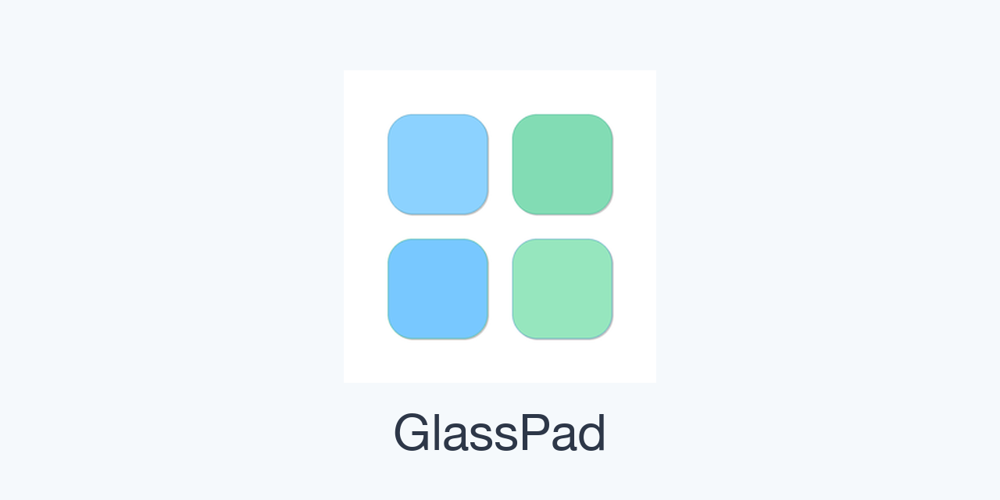

# GlassPad

macOS 原生 Launchpad 替代工具，采用 Liquid Glass 美学，全面支持无限屏画布、实时桌面壁纸捕获。

**本仓库为公开发布页**：只放版本标记、更新日志与安装包，**不含任何源码**。

## 下载 / Download

- **官方站点（下载 / 更新日志）：[glasspad.pocketbay.app](https://glasspad.pocketbay.app/)**
- **Releases（本仓库）：[GlassPad-1.0.420.dmg](https://github.com/anson55sky/GlassPad/releases/tag/v1.0.420)**
- 所有历史版本见 [Releases](https://github.com/anson55sky/GlassPad/releases)

## ⚠️ 开始前请先做一步（macOS 27 必读）

macOS 27 的四指捏合由**系统手势引擎直接接管，程序无法从内部关闭它**。要让它只唤起 GlassPad，需要你在系统设置里让出这两个手势：

**系统设置 → 触控板 → 更多手势**，把下面两项关掉：

| 开关 | 手势 | 说明 |
|---|---|---|
| **App** | 捏拢拇指和其他三指 | 系统的 App 面板 |
| **显示桌面** | 张开拇指和其他三指 | 系统的「显示桌面 / 推窗口」 |

关掉后：四指捏合只唤起 GlassPad；玻璃板关闭时，四指张开保持系统原生的「显示桌面」行为。

> GlassPad **从不写入你的任何系统偏好**。状态栏图标右键菜单里有「**关闭系统四指手势（打开系统设置）**」，点一下可直接跳到该页面。

**截图示意：**

| 关闭后（推荐） | 打开时（会冲突） |
|---|---|
|  |  |

## 安装 / Install

1. 下载 `.dmg`，将 **GlassPad** 拖入「应用程序」。
2. 首次打开若被 Gatekeeper 拦截：右键 App →「打开」，或在 **系统设置 → 隐私与安全性** 中点击「仍要打开」。
   （当前为自签名证书、尚未公证 Notarize，属正常提示。）
3. 首次启动后请授予**辅助功能**权限 —— 四指手势接管依赖它。
4. **壁纸权限说明**：静态图片壁纸无需任何权限；动态/Aerials 壁纸的高保真实时捕获可能需要「完全磁盘访问」，未授权时自动降级为系统资源，不会空白。

## 更新日志 / Changelog

### v1.0.420 · 多选整组拖拽 + 贪食蛇队列 + 性能大修 `[REQUIRED]`

- **长按多选**：空白处长按拖动框选，或长按任一图标进入多选；翻页 / 连续滚动下同样可用，跨页勾选不丢失。全选胶囊一键选中当前页。
- **抓取预览**：按住任一已选图标，其余成员在 0.3s 内快速排队到主件右侧，松手即弹回原位 —— 起拖之前就能看清这一组有谁。
- **贪食蛇组拖**：直接拖动则整组跟随，队列尾部振幅渐大、相位连续传播，横向不会折回穿插；落位时整组沿 0.30s 临界阻尼弹簧滑回各自格位，队列幽灵与真实图标在终点像素级互换。
- **完整渲染**：拖拽期间不再截断队伍，最多 64 个成员全部上屏；洞口宽度与组员数一致，松手时周围图标不再二次回流。
- **文件夹组拖**：文件夹内多选同样支持整组拖出 / 拖入，队列、摆尾与落位行为与主网格一致。
- **磁吸翻页 + 0.30s 逐帧落定**：滚轮 / 双指 / 鼠标收敛为同一套判定，跟手滞后归零；滚轮连续搓可连续翻页，动画期间不插队。
- **无限屏搜索**：全部结果铺到画布上，支持双指捏合缩放与滚轮平移。
- **性能**：召唤 / 关闭改走宿主层 CA 缩放（26ms/帧 → 8.3ms/帧）；面板关闭延迟 30~55ms → 0.1ms；召唤壁纸步进 31ms → 1ms。
- **卸载面板**：Buho 式明细表，系统应用保护；读不到大小就记账，不再显示 0；设置内新增完全磁盘访问入口；「应用位置」支持自定义目录。
- **签名**：改用自签名证书，完全磁盘访问授权不再随每次重建失效。

### v1.0.310 · 磁吸翻页 + 模糊档位 + 连续滚动开合修复 `[REQUIRED]`

**⚠️ 已在用的用户请重新授权一次辅助功能权限** —— 系统设置 → 隐私与安全性 → 辅助功能，把 GlassPad 重新打开一次。

- **磁吸：一次手势恒等于一页**（此前最多翻两页）。关键发现不是判定更聪明，而是 **Buho 的条带物理上就划不远** —— 跟手上限在四分之一页宽左右，怎么划都划不出「正在去第二页」的中间态，这才是磁吸感的来源。
  - 双指页内跟手：1:1 到 25% 页宽 → 渐进阻尼 → **渐近 16% 页宽（1.06 列）**。不是硬墙，是有墙但没墙挡着。
  - 翻页阈值 25% 页宽（378px）→ **8%（121px）**；四条翻页判定（双指/鼠标 × 主网格/文件夹）此前是**三套规则并存**，文件夹用固定 40px 阈值（页宽的 3.3%），同一手势在两处手感完全对不上，现已统一并硬钳 ±1。
- **位置门槛**：末速上限 6000px/s，光惯性投影就有 1920px —— 抬手指只走了 5%（61px）也会被算成 85% 而提交翻页。实测 44 次提交里 10 次（23%）属于这种越权，落定动画要在 0.3s 内跑完剩下 95% 页宽，其中 9 次变成 Q-jog 白弹（就是「非常卡顿」）。现在位移不过 12.5% 页宽时速度没有接管权；实测主网格 37 次提交拦下 7 次（19%）误翻、真翻页 0 误伤。
- **滚轮节流不再吞掉滚动累积**：被节流丢掉的那一下，翻页和它的滚动增量一起没了，闩锁却已上锁 —— 表现是「翻页一次后再快速翻第二次，过渡效果基本没了」，第二下不是没动画，是根本没发生。
- **文件夹两页之间有了 60pt 缝隙**：此前一个值同时当「一页多宽」和「翻一页走多远」，两者绑死导致缝隙只能是 0。内容宽没动，**静止观感零变化**。
- **模糊强度改 5 档**（关闭 / 轻度 / 中度 / 强度 / 超强），**松手才生效**。此前每拖 1% 就触发一次 3024×1964 全屏高斯模糊（实测 ~148ms），且合并循环会无条件发布过期结果 —— 面板落后滑块 250ms 以上、中途还会倒退；每次发布又触发整块面板重渲染，SwiftUI 一直忙，`ScrollView` 手势抢不到时间，于是**拖滑块变成滚动面板**。两个症状同一个根因。滑块本体改用系统原生 `Slider`，档位行等分排列、零绝对定位。
- **连续滚动模式开关面板「整层从右边挤进来」已修**：`fullW = max(rootW, padFrame.width)` 里的 `padFrame` 取的是**全局** frame，而它挂在挂了 `.scaleEffect` 的祖先之下，开合期间被撑大 1512→1587，ScrollView 比内容宽 75pt 导致内容居中右移。改成只用本地尺寸。**静止观感逐像素不变。**
- **鼠标拖拽保持 1:1**，不受双指阻尼影响 —— 鼠标是位置型输入，要能看着条带精确停在某两列之间再松手。

### v1.0.309 · 语言切换不再混排 + 辅助功能权限救援 `[REQUIRED]`

**⚠️ 如果你从 1.0.307 或更早升上来，请重新授权一次辅助功能权限** —— 那次授权绑在旧二进制的 cdhash 上，必须重授。设置 → 通用里有「辅助功能权限」状态行，可一键跳转并重新检测。

- **语言切换不再混排**，三类成因全部修完：
  - 42 个本地化 key 本身就是中文（`翻页`/`激活码`/`无限屏`…）。这类 key 的问题是「缺语言也会显示中文」，已全部改成英文 key。
  - 各语言缺口补齐：en 缺 44、zh-Hans 缺 5、zh-Hant 缺 23 → 现在均为 0。
  - 约 50 处 UI 硬编码中文 + 9 处写在元组里的裸中文，抽成本地化键。
- **语言范围收敛为 4 种**（跟随系统 / 简体中文 / 繁體中文 / English）。德/西/法/日/韩原先各只有 169 条词条，而实际用到 245 个 key，切过去会大面积混排 —— 缺语言宁可少提供。
- **辅助功能权限救援**：设置 → 通用新增状态行（绿✓/橙⚠︎ + 去授权/打开系统设置/重新检测）；状态栏菜单新增 ⚠︎ 警告项；启动时自动检测 + 200ms 轮询。
- 修掉两个真 bug：带 `%@` 的文案直接赋值导致界面显示字面的 `%@`；`build.sh` 只 `cp` 不删 `.lproj`，删掉语言后旧语言包仍留在产物里。
- **新增构建期校验 `loc_guard.py`**（编译前跑，不通过直接让构建失败）：中文 key / 缺 key / 重复 key / 格式符不匹配 / 裸中文字面量 / en 译文混入中文 / 占位符没套 `String(format:)`。每一类都做了反向验证。
- 验证：构建产物 245 个 key × 3 种语言**全量解析**，en 混入中文 **0** 条。

### v1.0.308 · 辅助功能权限根治 + 手势误唤醒修复

- **辅助功能权限在每次更新后都会失效**（根因修复）。原因是 ad-hoc 签名的
  designated requirement 建在代码哈希上，而每次重新编译哈希都变，系统据此
  认定「这是一个新程序」而作废既有授权。表现为：更新后四指手势接管静默失效。
  现在签名锚定 bundle 标识，**授权跨更新不再丢失**。
- **拇指先下再三指捏合不再误唤醒**：对齐 Buho —— 只有四指同时捏合才触发。
- 文件夹开合帧率 38.6 → 63 fps；点击到起跳 72.1 → 20.5 ms；首次召唤 717 → 459 ms。
- 修复刘海遮挡下文件夹名称被裁掉的问题。
- 已知未解决：文件夹底板玻璃在「设置」窗口打开时会消失（原生玻璃跟随窗口焦点）。

### v1.0.307 · 移除残留自愈

- 移除 1.0.306 后残留的 `cleanupLegacyWrites` 自愈 —— 它把用户在系统设置里手动关闭的四指手势判作旧版本残留并删掉，悄悄恢复系统手势。
- GlassPad 此后永远「不写入、不删除」你的系统偏好，只读探测 + 状态栏直达系统设置。

### v1.0.306 · 手势冲突根治

- 四指捏合与四指张开全面对齐 Buho：捏合只唤起 GlassPad，系统 App 面板不再常驻弹出；玻璃板关闭时四指张开保持系统原生行为。
- **移除全部修改系统偏好的代码** —— GlassPad 从不写入你的系统设置，只在状态栏提供「打开系统设置」快捷入口。
- 修复 App 内自动更新此前指向私有仓库导致恒 404 的问题。
- 修复站点下载端点版本号写死导致「更新后仍下载到旧包」的问题。

### v1.0.248 – 1.0.250 · 隐私 + 手势接管

- **壁纸改用系统壁纸窗口接口抓取，彻底去掉录屏（屏幕录制）授权**。
- 四指捏合改由 CGEventTap 接管，退出时完整归还给系统。

### v1.0.251 – 1.0.262 · 文件夹延伸

- 文件夹面板改为横向撑开，刚体缩放取代逐图标飞行；锚点锁定到被点 badge 中心。

### v1.0.262 – 1.0.269 · 开合对齐

- 主页面开合节奏对齐 Buho；不再收走系统菜单栏，顺带根治打开时 Dock 闪烁。

### v1.0.153 – 1.0.190 · 手势与动效

- 捏合召唤全程跟手；修复慢速捏合卡死、手势期四角变尖角；玻璃色调持久化修复；文件夹支持滚轮翻页。

## 自动更新 / Auto-update

App 内「设置 → 检查更新」会比对本仓库与官网的 Releases。

## 许可与发布策略 / License & Distribution

- 当前为 **内测版（Open Beta）**，**全部功能免费，无需激活码**。
- **源码不公开**，本仓库仅存放版本存档、更新日志与安装包。
- 站内下载统一走官网 [glasspad.pocketbay.app](https://glasspad.pocketbay.app/)。